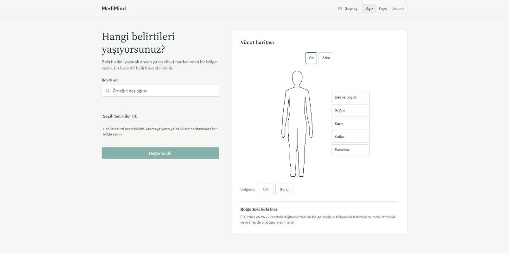
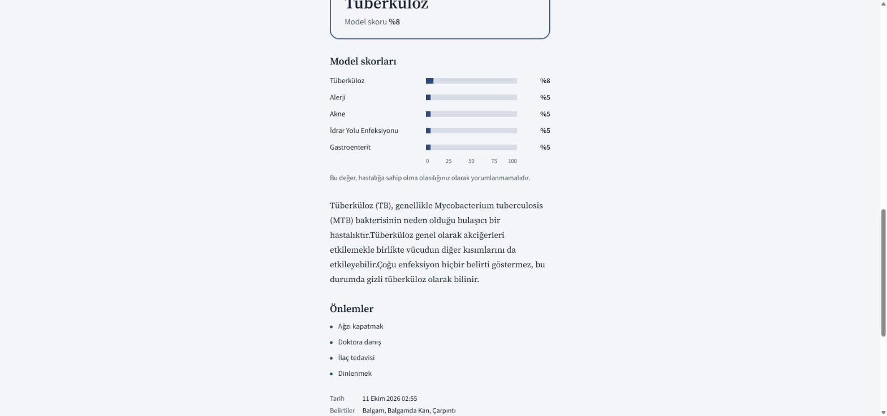
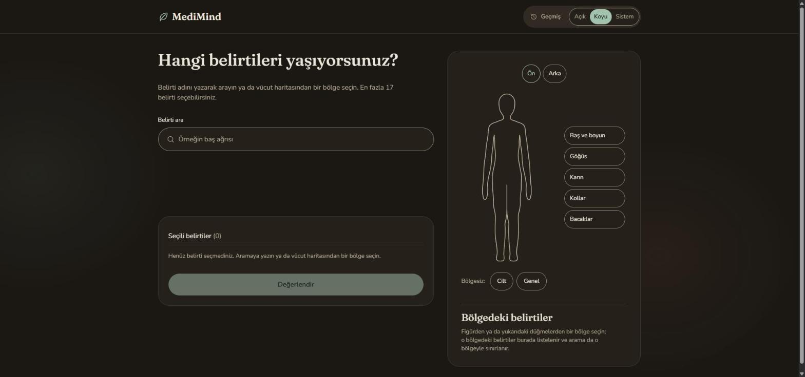
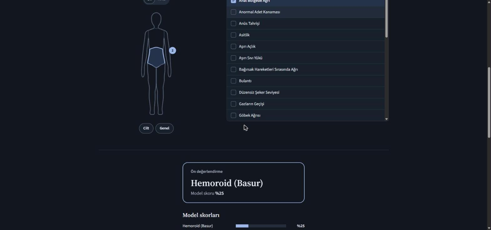
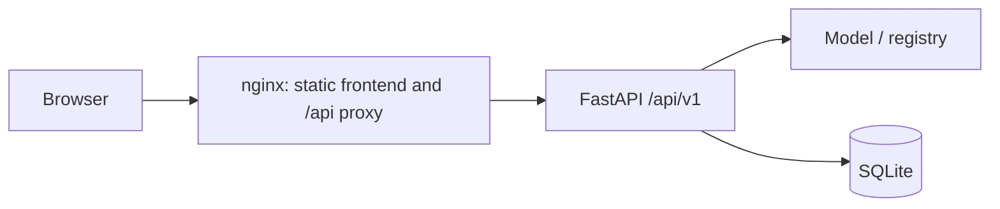

**English** | [Türkçe](README.tr.md)

## MediMind

MediMind is a Turkish preliminary assessment tool that ranks diseases using a machine learning model based on selected symptoms. It presents disease descriptions and precautions from the dataset; it does not diagnose or replace a physician's assessment. It was developed for educational and informational purposes.

## Screenshots

| Overview | Image |
|---|---|
| Light theme: symptom selection |  |
| Light theme: result |  |
| Dark theme: symptom selection |  |
| Dark theme: result |  |

## Features

The backend uses the new API and data structure; the frontend rewrite is in progress. The interface design goals are:

- Probability scale: up to five diseases are shown with single-color bars on a shared 0–100 scale; displayed scores are not renormalized to 100%.
- Body figure with region filter: Head and neck, Chest, Abdomen, Back, Arms, and Legs; Skin and General are separate filters. Selecting a region filters the list and does not select symptoms automatically. The mappings come from `backend/data/body_regions.json`.
- Score policy: the format `Model skoru` (Model score) `%42` is used; values below 1% are shown as `<%1`. No threshold badge or color-coded confidence system is used; the API's `confidence_label` is not shown in the interface. Fixed explanation: “This value should not be interpreted as your probability of having the disease.”
- Printable report: the browser's print/save as PDF function uses `@media print`, A4, and 15 mm margins. The report includes the date, request IDs, symptoms, scale, explanation, precautions, and warning.
- Anonymous history: a UUID stored in the browser is sent to the server via `X-Client-Id`; assessments are listed and deleted in SQLite by this ID. This ID is not an account or an authentication mechanism.
- Light, dark, and system themes; Source Serif 4 for headings and IBM Plex Sans for body text.
- Accessibility: keyboard-operable search and region filters, visible focus, focus transfer to the result heading, ARIA status announcements, and reduced motion preference. WCAG AA contrast is targeted in both themes.
- A warning that the report is out of date when symptoms change; symptom severity is presented only as plain text with an explanation in the “Teknik ayrıntılar” (Technical details) section.

## Architecture

The backend uses FastAPI, Pydantic v2, and SQLAlchemy 2.0. On application startup, the model artifact and data registry are loaded; feature set and hash consistency are validated. Prediction logic is independent of the HTTP layer; history is stored in SQLite. The frontend is built with Vite, React 18, TypeScript, Tailwind CSS, TanStack Query, and Zod.

In Docker deployment, nginx serves the static frontend files and routes `/api/` requests to the backend. In local development, Vite provides the same routing.



The tree below summarizes the backend packages and the planned modular structure for the frontend:

```text
.
├── backend/
│   ├── app/
│   │   ├── main.py               # create_app and lifespan
│   │   ├── core/                 # config, logging, middleware, errors, paths
│   │   ├── schemas/              # request and response schemas
│   │   ├── ml/                   # preprocessing, artifact, registry, predictor,
│   │   │                         # evaluate, train, compare_artifacts
│   │   ├── services/             # symptom, disease, prediction, and history services
│   │   ├── db/                   # models and session management
│   │   └── api/v1/               # health, symptoms, predict, diseases, history
│   ├── data/                     # CSV/JSON, symptoms.json, body_regions.json
│   ├── models/                   # disease_model.joblib, model_card.json
│   ├── scripts/                  # one-off data tools
│   ├── tests/                    # unit, api, ml, fixtures
│   ├── pyproject.toml
│   └── uv.lock
├── frontend/
│   ├── src/
│   │   ├── main.tsx, App.tsx
│   │   ├── app/                  # shell, heading, theme toggle
│   │   ├── styles/               # tokens.css, base.css, print.css
│   │   ├── lib/api/              # client, Zod schemas, queries
│   │   ├── lib/                  # clientId, theme, formatting
│   │   ├── features/
│   │   │   ├── symptoms/body-map/ # symptom selection and body figure
│   │   │   ├── assessment/       # report, scale, printing, freshness warning
│   │   │   └── history/          # history drawer
│   │   ├── components/ui/        # shared interface components
│   │   └── test/                 # setup, MSW, fixtures
│   ├── package.json
│   └── nginx.conf
├── screenshots/
├── Makefile
├── docker-compose.yml
└── .env.example
```

## API (v1)

The base path is `/api/v1`; the local OpenAPI interface is at `http://localhost:8000/docs`. `X-Request-ID` is optional on all requests; a valid incoming ID is echoed in the response header, or the server creates one if none is provided. `X-Client-Id` must be in UUID format. When accessed through Docker, nginx passes its own `$request_id` value to the backend; the client's request ID is replaced at this layer.

| Method | Path | Description | `X-Client-Id` | `X-Request-ID` |
|---|---|---|---|---|
| GET | `/api/v1/health` | Model and database status; 503 when unhealthy | Not required | Optional; returned in response |
| GET | `/api/v1/symptoms` | Turkish label, region, weight, and region list; `Cache-Control: max-age=3600` | Not required | Optional; returned in response |
| POST | `/api/v1/predict` | Evaluates symptoms; saves to history if an ID is present | Optional | Optional; returned in response |
| GET | `/api/v1/diseases` | Disease list | Not required | Optional; returned in response |
| GET | `/api/v1/diseases/{id}` | Disease description and precautions; 404 if not found | Not required | Optional; returned in response |
| GET | `/api/v1/history?limit=50&offset=0` | History for the ID; `limit` 1–500, `offset` at least 0 | Required | Optional; returned in response |
| DELETE | `/api/v1/history` | Deletes all history for the ID; 204 | Required | Optional; returned in response |
| DELETE | `/api/v1/history/{id}` | Deletes one record for the ID; 204, 404 if not found | Required | Optional; returned in response |

`predict` accepts at least one symptom; the default limit is 17 symptoms after normalization and deduplication. An unknown symptom returns 422; an invalid or required-but-missing client ID returns 400. If `X-Client-Id` is not sent, the prediction is not saved and `analysis_id` is `null`. The legacy `/symptoms` and `/predict` routes are marked for deprecation for backward compatibility; new clients should use v1.

Errors are returned with `Content-Type: application/problem+json`. Example of an unknown symptom:

```json
{
  "type": "urn:medimind:problem:unknown_symptom",
  "title": "Unprocessable Entity",
  "status": 422,
  "detail": "Unknown symptom(s): yok_boyle_bir_sey",
  "code": "unknown_symptom",
  "request_id": "6f1c2d0e9a8b4c7d8e9f0a1b2c3d4e5f",
  "errors": [{"symptom": "yok_boyle_bir_sey"}]
}
```

Example request from Bash or Git Bash:

```bash
curl -sS -X POST http://localhost:8000/api/v1/predict \
  -H 'Content-Type: application/json' \
  -H 'X-Client-Id: 11111111-1111-4111-8111-111111111111' \
  -H 'X-Request-ID: 6f1c2d0e9a8b4c7d8e9f0a1b2c3d4e5f' \
  -d '{"symptoms":["itching","skin_rash","nodal_skin_eruptions","dischromic_patches"]}'
```

Representative example showing the response schema; the score, record ID, and time may vary in an actual run:

```json
{
  "request_id": "6f1c2d0e9a8b4c7d8e9f0a1b2c3d4e5f",
  "analysis_id": 12,
  "model_version": "20261010-lr-59a12e81",
  "input": {
    "symptoms": ["itching", "skin_rash", "nodal_skin_eruptions", "dischromic_patches"],
    "count": 4
  },
  "top_prediction": {
    "disease_id": "fungal_infection",
    "name": "Mantar Enfeksiyonu",
    "name_en": "Fungal infection",
    "probability": 0.98,
    "description": "Mantar kaynaklı enfeksiyonlar.",
    "precautions": ["İki kez banyo yapmak"]
  },
  "predictions": [
    {"disease_id": "fungal_infection", "name": "Mantar Enfeksiyonu", "probability": 0.98}
  ],
  "severity": {"score": 14, "max_possible": 28, "mean_weight": 3.5, "level": "moderate"},
  "confidence_label": "high",
  "disclaimer": true,
  "created_at": "2026-10-10T12:00:00Z"
}
```

`predictions` contains up to five results by default and includes scores of at least `0.01`. The `probability` field is a model output; it should not be interpreted as a person's probability of having the disease.

## Model and data

Source: [Disease Symptom Prediction](https://www.kaggle.com/datasets/itachi9604/disease-symptom-description-dataset). The dataset contains 4,920 rows, 131 symptoms, 41 diseases, and only 304 distinct symptom combinations. A random row-based train/test split causes data leakage by distributing duplicates across both sets.

Symptom names are converted to canonical `snake_case`; spaces and repeated underscores are corrected, and known typos are consolidated through alias mappings. Legacy names with spaces are also accepted. Symptom combinations are converted into binary feature vectors; Turkish labels, region mappings, descriptions, precautions, and symptom weights are provided through the registry.

The distributed model is multinomial logistic regression with the `lbfgs` solver. According to the [model card](backend/models/model_card.json), **C=10.0**, selected by group-CV log-loss from the range `[0.3, 1.0, 3.0, 10.0]`, uses seed 42. The model version is `20261010-lr-59a12e81`; the artifact is at `backend/models/disease_model.joblib`. Random forest is only a comparison model.

Evaluation uses three views: five-fold `StratifiedGroupKFold` grouped by symptom-combination hash, `LeaveOneGroupOut` (LOGO) on the 304-row deduplicated table, and a perturbation test that randomly removes one symptom from test combinations. Perturbation includes three repetitions, for a total of 912 evaluations.

| Metric | Value in model card |
|---|---|
| Group-CV accuracy (mean ± std) | 1.0 ± 0.0 |
| Group-CV macro-F1 (mean ± std) | 1.0 ± 0.0 |
| Group-CV top-3 (mean ± std) | 1.0 ± 0.0 |
| Group-CV log-loss (mean ± std) | 0.0042 ± 0.0009 |
| Group-CV multiclass Brier (mean ± std) | 0.0001 ± 0.0001 |
| Dedup LOGO accuracy / macro-F1 / top-3 | 1.0 / 1.0 / 1.0 |
| Perturbation top-1 / top-3 | 0.9967 / 1.0 |

| Comparison | Logistic regression | Random forest |
|---|---|---|
| Group-CV macro-F1 | 1.0 | 0.9974 |
| Group-CV top-3 | 1.0 | 1.0 |
| Group-CV log-loss | 0.0042 | 0.1395 |
| Group-CV Brier | 0.0001 | 0.0515 |
| Dedup LOGO macro-F1 | 1.0 | 1.0 |
| Perturbation top-3 | 1.0 | 1.0 |

**Honest note:** The dataset is synthetic and near-separable; even group-based cross-validation reaches 1.0. These metrics document the evaluation method, do not distinguish between models, and do not show real-world accuracy. The scores are not calibrated as clinical disease probabilities. The severity score is calculated from symptom weights in the dataset; it is not an indicator of clinical seriousness or urgency and cannot be used for triage.

## Setup and run

Requirements: `uv`, Python 3.12 (`>=3.12,<3.13`; uv can install it if missing), Node.js 22, and npm. GNU Make and a compatible shell are needed for Make targets; `pre-commit` must be on PATH for `make setup`. Docker Compose is optional.

Install the pre-commit tool and set up dependencies from the root directory:

```bash
uv tool install pre-commit
make setup
```

Run in two separate terminals:

```bash
make dev-backend
```

```bash
make dev-frontend
```

The frontend is at `http://localhost:5173`, the backend at `http://localhost:8000`, and the API documentation at `http://localhost:8000/docs`. The ready-made model artifact is used; training is not required for the first run.

If Make is unavailable on Windows, run the commands from the Makefile directly. Install dependencies from the root directory using PowerShell:

```powershell
uv tool install pre-commit
Set-Location backend
uv sync --all-groups
Set-Location ../frontend
npm ci
Set-Location ..
pre-commit install
```

First terminal opened from the root directory:

```powershell
Set-Location backend
uv run uvicorn app.main:app --reload --port 8000
```

Second terminal:

```powershell
Set-Location frontend
npm run dev
```

With Docker, from the root directory:

```bash
cp .env.example .env
docker compose up --build
```

The equivalent copy command in PowerShell is `Copy-Item .env.example .env`. Open the app at `http://localhost:8080`. The backend does not publish a port externally; it is accessed through nginx. SQLite data is stored in the persistent volume named `medimind-db`.

For local backend settings, you can copy `backend/.env.example` to `backend/.env`. The root `.env.example` is for Docker; its `/app/data/db` database path is not suitable for local runs. Frontend settings are read from `frontend/.env`. If `VITE_API_BASE_URL` is empty, `/api/v1` goes through the Vite/nginx proxy on the same origin; if set, provide only the origin (for example, `http://localhost:8000`), and `/api/v1` is appended on the client side.

| Variable | Local default | Description / Docker example |
|---|---|---|
| `MEDIMIND_APP_ENV` | `development` | `development`, `test`, `production`; Docker: `production` |
| `MEDIMIND_APP_VERSION` | `0.2.0` | Application version in the health response |
| `MEDIMIND_LOG_LEVEL` | `INFO` | Log level |
| `MEDIMIND_LOG_FORMAT` | `text` | `text` or `json`; Docker: `json` |
| `MEDIMIND_DATABASE_URL` | `sqlite:///./data/medimind.db` | Relative SQLite path is resolved from the backend; Docker: `sqlite:////app/data/db/medimind.db` |
| `MEDIMIND_CORS_ORIGINS` | `["http://localhost:5173","http://127.0.0.1:5173"]` | JSON list; Docker: `["http://localhost:8080"]` |
| `MEDIMIND_DATA_DIR` | `backend/data` | Data registry directory |
| `MEDIMIND_MODEL_DIR` | `backend/models` | Artifact and model card directory |
| `MEDIMIND_MAX_SYMPTOMS` | `17` | Deduplicated symptom limit (1–131) |
| `MEDIMIND_TOP_K` | `5` | Maximum number of results (1–41) |
| `MEDIMIND_MIN_PROB` | `0.01` | Minimum model score for results to be included in the list |
| `MEDIMIND_HISTORY_LIMIT` | `50` | Default history page size (1–500) |
| `MEDIMIND_SEVERITY_LOW_BELOW` | `3.0` | Low-level threshold for average dataset weight |
| `MEDIMIND_SEVERITY_MODERATE_BELOW` | `5.0` | Moderate-level threshold for average dataset weight |
| `MEDIMIND_CONFIDENCE_HIGH_AT` | `0.6` | API confidence label threshold; not shown in the interface |
| `MEDIMIND_CONFIDENCE_MEDIUM_AT` | `0.3` | API confidence label threshold; not shown in the interface |
| `VITE_API_BASE_URL` | Empty | API origin; embedded in the frontend at build time |

## Development

Common targets from the root directory:

```bash
make test
make lint
make typecheck
make format
```

`make test` runs backend tests with a coverage report and frontend tests in one go. `make lint` covers Ruff lint/format checks, mypy, ESLint, and Prettier checks; `make typecheck` also runs the frontend TypeScript check. `make format` formats files and applies Ruff fixes.

Without Make, from the backend directory:

```bash
uv run pytest
uv run pytest -q --cov=app --cov-report=term-missing
uv run ruff check .
uv run ruff format --check .
uv run mypy app
```

From the frontend directory:

```bash
npm test -- --run
npm run lint
npm run format:check
npm run typecheck
npm run build
```

Backend tests cover normalization, registry coverage, artifact validation, prediction logic, API error format, and history isolation. The minimum coverage threshold is 85%. Frontend test targets are symptom selection, filtering, report/freshness flow, API errors, and print view; implementation of this interface is in progress.

Pre-commit setup is included in `make setup`; to install and run checks separately, from the root directory:

```bash
uv tool install pre-commit
pre-commit install
pre-commit run --all-files
```

Hooks check trailing whitespace, end-of-file, YAML, merge markers, and new files over 2,048 KB; they run Ruff fixes/formatting in the backend and lint and format checks in the frontend.

CI runs Python 3.12, `uv sync --frozen --all-groups`, Ruff, mypy, and pytest with coverage for the backend; and Node 22, `npm ci`, lint, format check, typecheck, tests, and build for the frontend on `main` pushes and pull requests. `train-check` retrains the model and compares artifacts. On `main`, Docker images are built after the backend and frontend jobs succeed.

To retrain, from the backend directory:

```bash
uv run medimind-train --out models
```

This command refreshes the model artifact, model card, and `data/symptoms.json`. To check for drift while preserving the current artifact, use a separate output directory:

```bash
uv run medimind-train --out models/retrain
uv run python -m app.ml.compare_artifacts models/disease_model.joblib models/retrain/disease_model.joblib
```

`compare_artifacts` checks that the feature hash and ordered class list match; it fails if the absolute difference between the group-CV macro-F1 means in the model cards exceeds the default `0.02` tolerance. This check is not clinical validity or calibration validation. CI performs the same operation with the `/tmp/retrain` output directory.

## Medical disclaimer

This project is for educational and informational purposes only. The result is not a diagnosis; it is the output of a machine learning model trained on a limited dataset. Disease descriptions and precautions do not constitute personalized medical advice or a treatment plan. Consult a qualified physician about your health concerns; do not start, change, or delay treatment based on the results. **In an emergency, call 112 in Turkey without waiting for the assessment result.**

## License

[MIT License](LICENSE.txt).

Developer: **Ayberk Arda**.

