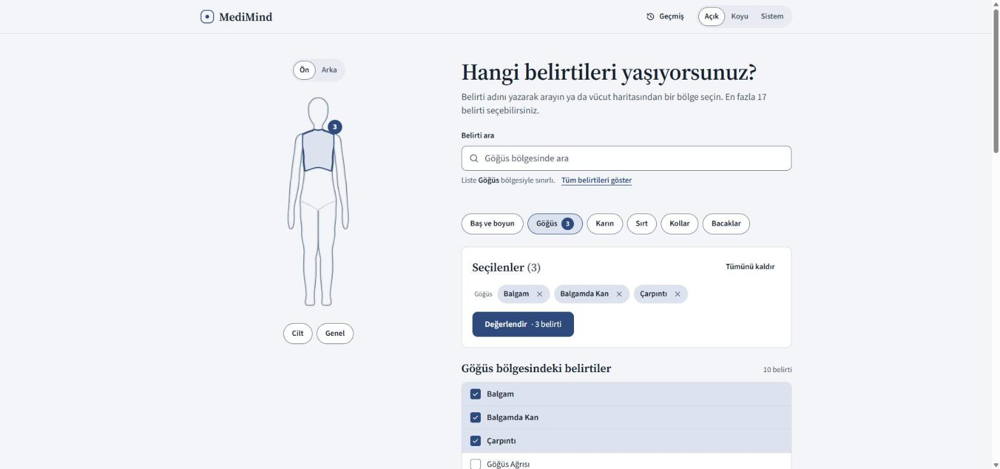
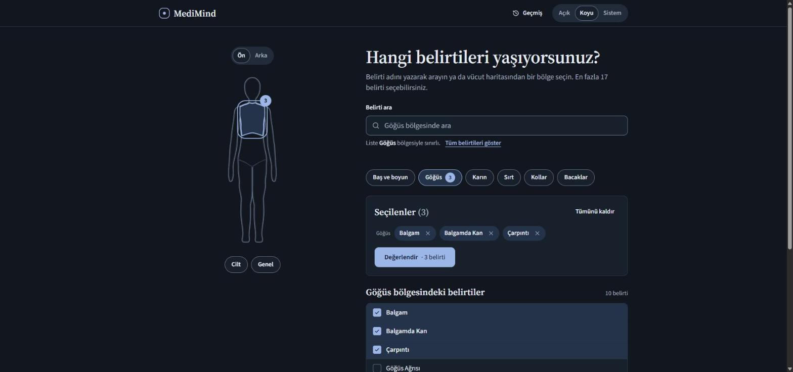
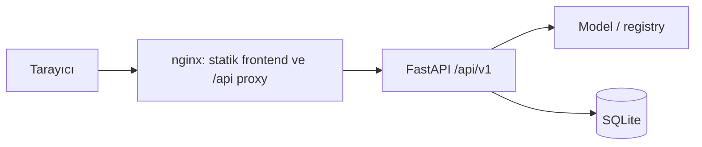

[English](README.md) | **Türkçe**

## MediMind

MediMind, seçilen belirtilerden hastalıkları makine öğrenmesi modeliyle sıralayan Türkçe bir ön değerlendirme aracıdır. Hastalık açıklamalarını ve veri setindeki önlemleri sunar; teşhis koymaz ve hekim değerlendirmesinin yerine geçmez. Eğitim ve bilgilendirme amacıyla geliştirilmiştir.

## Ekran görüntüleri

| Görünüm | Görsel |
|---|---|
| Açık tema: başlangıç |  |
| Açık tema: belirti seçimi |  |
| Açık tema: sonuç |  |
| Koyu tema: başlangıç |  |
| Koyu tema: belirti seçimi |  |
| Koyu tema: sonuç |  |

## Özellikler

Backend yeni API ve veri yapısını kullanır; frontend yeniden yazımı devam etmektedir. Arayüzün tasarım hedefleri:

- Olasılık cetveli: en fazla beş hastalık, ortak 0–100 ekseninde tek renkli çubuklarla gösterilir; görüntülenen skorlar yeniden %100'e normalize edilmez.
- Vücut figürü ile bölge filtresi: Baş-boyun, Göğüs, Karın, Sırt, Kollar ve Bacaklar; Cilt ve Genel ayrı filtrelerdir. Bölge seçimi listeyi filtreler, otomatik belirti seçmez. Eşlemelerin kaynağı `backend/data/body_regions.json` dosyasıdır.
- Skor politikası: `Model skoru %42` biçimi kullanılır; %1 altı `<%1` olarak gösterilir. Eşik rozeti veya renkli güven kodu kullanılmaz; API'deki `confidence_label` arayüzde gösterilmez. Sabit açıklama: “Bu değer, hastalığa sahip olma olasılığınız olarak yorumlanmamalıdır.”
- Yazdırılabilir rapor: tarayıcının yazdırma/PDF olarak kaydetme işlevi, `@media print`, A4 ve 15 mm kenar boşluğu kullanılır. Tarih, işlem kimlikleri, belirtiler, cetvel, açıklama, önlemler ve uyarı raporda yer alır.
- Anonim geçmiş: tarayıcıda saklanan UUID, `X-Client-Id` ile sunucuya gönderilir; değerlendirmeler SQLite'ta bu kimliğe göre listelenir ve silinir. Bu kimlik bir hesap veya kimlik doğrulama mekanizması değildir.
- Açık, karanlık ve sistem teması; düşük doygunluklu arduvaz ve sis paleti (serin sis zemin üzerinde arduvaz mavisi vurgu), başlıklar ve hastalık adı için Source Serif 4, arayüz ve gövde metni için Source Sans 3. Tek bir odak penceresi seçilen vücut bölgesini çerçeveler ve sonuç başlığının çerçevesine dönüşür.
- Erişilebilirlik: klavye ile kullanılabilen arama ve bölge filtreleri, görünür odak, sonuç başlığına odak aktarımı, ARIA durum bildirimleri ve azaltılmış hareket tercihi. İki temada WCAG AA kontrast hedeflenir.
- Belirtiler değiştiğinde raporun güncel olmadığını belirten uyarı; belirti ağırlığı yalnızca “Teknik ayrıntılar” bölümünde açıklamalı düz metin olarak sunulur.

## Mimari

Backend FastAPI, Pydantic v2 ve SQLAlchemy 2.0 kullanır. Uygulama açılışında model artifact'i ve veri kayıtları (registry) yüklenir; özellik kümesi ve hash tutarlılığı doğrulanır. Tahmin mantığı HTTP katmanından bağımsızdır; geçmiş SQLite'ta tutulur. Frontend Vite, React 18, TypeScript, Tailwind CSS, TanStack Query ve Zod üzerine kuruludur.

Docker dağıtımında nginx statik frontend dosyalarını sunar ve `/api/` isteklerini backend'e yönlendirir. Yerel geliştirmede aynı yönlendirmeyi Vite yapar.



Aşağıdaki ağaç backend paketlerini ve frontend için hedeflenen modüler yapıyı özetler:

```text
.
├── backend/
│   ├── app/
│   │   ├── main.py               # create_app ve lifespan
│   │   ├── core/                 # config, logging, middleware, errors, paths
│   │   ├── schemas/              # istek ve yanıt şemaları
│   │   ├── ml/                   # preprocessing, artifact, registry, predictor,
│   │   │                         # evaluate, train, compare_artifacts
│   │   ├── services/             # belirti, hastalık, tahmin ve geçmiş servisleri
│   │   ├── db/                   # modeller ve oturum yönetimi
│   │   └── api/v1/               # health, symptoms, predict, diseases, history
│   ├── data/                     # CSV/JSON, symptoms.json, body_regions.json
│   ├── models/                   # disease_model.joblib, model_card.json
│   ├── scripts/                  # tek seferlik veri araçları
│   ├── tests/                    # unit, api, ml, fixtures
│   ├── pyproject.toml
│   └── uv.lock
├── frontend/
│   ├── src/
│   │   ├── main.tsx, App.tsx
│   │   ├── app/                  # kabuk, başlık, tema anahtarı
│   │   ├── styles/               # tokens.css, base.css, print.css
│   │   ├── lib/api/              # istemci, Zod şemaları, sorgular
│   │   ├── lib/                  # clientId, tema, biçimleme
│   │   ├── features/
│   │   │   ├── symptoms/body-map/ # belirti seçimi ve vücut figürü
│   │   │   ├── assessment/       # rapor, cetvel, yazdırma, güncellik uyarısı
│   │   │   └── history/          # geçmiş çekmecesi
│   │   ├── components/ui/        # ortak arayüz bileşenleri
│   │   └── test/                 # kurulum, MSW, fixtures
│   ├── package.json
│   └── nginx.conf
├── screenshots/
├── Makefile
├── docker-compose.yml
└── .env.example
```

## API (v1)

Temel yol `/api/v1`; yerel OpenAPI arayüzü `http://localhost:8000/docs` adresindedir. `X-Request-ID` tüm isteklerde isteğe bağlıdır; geçerli gelen kimlik yanıt başlığında yankılanır, yoksa sunucu bir kimlik oluşturur. `X-Client-Id` UUID biçimindedir. Docker üzerinden erişimde nginx, backend'e kendi `$request_id` değerini iletir; istemcinin gönderdiği istek kimliği bu katmanda değiştirilir.

| Method | Yol | Açıklama | `X-Client-Id` | `X-Request-ID` |
|---|---|---|---|---|
| GET | `/api/v1/health` | Model ve veritabanı durumu; bozulmuş durumda 503 | Gerekmez | İsteğe bağlı; yanıtta döner |
| GET | `/api/v1/symptoms` | Türkçe etiket, bölge, ağırlık ve bölge listesi; `Cache-Control: max-age=3600` | Gerekmez | İsteğe bağlı; yanıtta döner |
| POST | `/api/v1/predict` | Belirtileri değerlendirir; kimlik varsa geçmişe kaydeder | İsteğe bağlı | İsteğe bağlı; yanıtta döner |
| GET | `/api/v1/diseases` | Hastalık listesi | Gerekmez | İsteğe bağlı; yanıtta döner |
| GET | `/api/v1/diseases/{id}` | Hastalık açıklaması ve önlemler; bulunamazsa 404 | Gerekmez | İsteğe bağlı; yanıtta döner |
| GET | `/api/v1/history?limit=50&offset=0` | Kimliğe ait geçmiş; `limit` 1–500, `offset` en az 0 | Zorunlu | İsteğe bağlı; yanıtta döner |
| DELETE | `/api/v1/history` | Kimliğe ait tüm geçmişi siler; 204 | Zorunlu | İsteğe bağlı; yanıtta döner |
| DELETE | `/api/v1/history/{id}` | Kimliğe ait tek kaydı siler; 204, bulunamazsa 404 | Zorunlu | İsteğe bağlı; yanıtta döner |

`predict` en az bir belirti kabul eder; normalizasyon ve tekilleştirmeden sonra varsayılan sınır 17 belirtidir. Bilinmeyen belirti 422, geçersiz veya zorunlu olduğu halde eksik istemci kimliği 400 döndürür. `X-Client-Id` gönderilmezse tahmin kaydedilmez ve `analysis_id` değeri `null` olur. Eski `/symptoms` ve `/predict` rotaları geçiş uyumluluğu için kullanım dışına çıkarılmak üzere işaretlenmiştir; yeni istemciler v1 kullanmalıdır.

Hatalar `Content-Type: application/problem+json` ile döner. Bilinmeyen belirti örneği:

```json
{
  "type": "urn:medimind:problem:unknown_symptom",
  "title": "Unprocessable Entity",
  "status": 422,
  "detail": "Unknown symptom(s): yok_boyle_bir_sey",
  "code": "unknown_symptom",
  "request_id": "6f1c2d0e9a8b4c7d8e9f0a1b2c3d4e5f",
  "errors": [{"symptom": "yok_boyle_bir_sey"}]
}
```

Bash veya Git Bash üzerinden örnek istek:

```bash
curl -sS -X POST http://localhost:8000/api/v1/predict \
  -H 'Content-Type: application/json' \
  -H 'X-Client-Id: 11111111-1111-4111-8111-111111111111' \
  -H 'X-Request-ID: 6f1c2d0e9a8b4c7d8e9f0a1b2c3d4e5f' \
  -d '{"symptoms":["itching","skin_rash","nodal_skin_eruptions","dischromic_patches"]}'
```

Yanıt şemasını gösteren temsili örnek; skor, kayıt kimliği ve zaman gerçek çalıştırmada değişebilir:

```json
{
  "request_id": "6f1c2d0e9a8b4c7d8e9f0a1b2c3d4e5f",
  "analysis_id": 12,
  "model_version": "20261010-lr-59a12e81",
  "input": {
    "symptoms": ["itching", "skin_rash", "nodal_skin_eruptions", "dischromic_patches"],
    "count": 4
  },
  "top_prediction": {
    "disease_id": "fungal_infection",
    "name": "Mantar Enfeksiyonu",
    "name_en": "Fungal infection",
    "probability": 0.98,
    "description": "Mantar kaynaklı enfeksiyonlar.",
    "precautions": ["İki kez banyo yapmak"]
  },
  "predictions": [
    {"disease_id": "fungal_infection", "name": "Mantar Enfeksiyonu", "probability": 0.98}
  ],
  "severity": {"score": 14, "max_possible": 28, "mean_weight": 3.5, "level": "moderate"},
  "confidence_label": "high",
  "disclaimer": true,
  "created_at": "2026-10-10T12:00:00Z"
}
```

`predictions`, varsayılan olarak en fazla beş sonuç ve en az `0.01` skor içerir. `probability` alanı model çıktısıdır; kişinin hastalığa sahip olma olasılığı olarak yorumlanmamalıdır.

## Model ve veri

Kaynak: [Disease Symptom Prediction](https://www.kaggle.com/datasets/itachi9604/disease-symptom-description-dataset). Veri setinde 4.920 satır, 131 belirti, 41 hastalık ve yalnızca 304 farklı belirti kümesi vardır. Rastgele satır bazlı eğitim/test ayrımı tekrarları iki tarafa dağıtarak veri sızıntısına yol açar.

Belirti adları kanonik `snake_case` biçimine çevrilir; boşluklar ve tekrarlanan alt çizgiler düzeltilir, bilinen yazım hataları alias eşlemeleriyle birleştirilir. Eski boşluklu adlar da kabul edilir. Belirti kümeleri ikili özellik vektörlerine dönüştürülür; Türkçe etiketler, bölge eşlemeleri, açıklamalar, önlemler ve belirti ağırlıkları registry üzerinden sağlanır.

Dağıtılan model `lbfgs` çözücülü multinomial lojistik regresyondur. [Model kartına](backend/models/model_card.json) göre `[0.3, 1.0, 3.0, 10.0]` aralığında grup-CV log-loss ile seçilen **C=10.0**, seed 42'dir. Model sürümü `20261010-lr-59a12e81`; artifact `backend/models/disease_model.joblib` içindedir. Random forest yalnızca karşılaştırma modelidir.

Değerlendirme üç görünüm kullanır: belirti kümesi hash'iyle gruplanmış beş katlı `StratifiedGroupKFold`, 304 satırlık tekilleştirilmiş tabloda `LeaveOneGroupOut` (LOGO) ve test kombinasyonlarından rastgele bir belirti çıkarılan perturbasyon testi. Perturbasyon üç tekrar, toplam 912 değerlendirme içerir.

| Ölçüm | Model kartındaki değer |
|---|---|
| Grup-CV accuracy (ortalama ± std) | 1.0 ± 0.0 |
| Grup-CV macro-F1 (ortalama ± std) | 1.0 ± 0.0 |
| Grup-CV top-3 (ortalama ± std) | 1.0 ± 0.0 |
| Grup-CV log-loss (ortalama ± std) | 0.0042 ± 0.0009 |
| Grup-CV çok sınıflı Brier (ortalama ± std) | 0.0001 ± 0.0001 |
| Dedup LOGO accuracy / macro-F1 / top-3 | 1.0 / 1.0 / 1.0 |
| Perturbasyon top-1 / top-3 | 0.9967 / 1.0 |

| Karşılaştırma | Lojistik regresyon | Random forest |
|---|---|---|
| Grup-CV macro-F1 | 1.0 | 0.9974 |
| Grup-CV top-3 | 1.0 | 1.0 |
| Grup-CV log-loss | 0.0042 | 0.1395 |
| Grup-CV Brier | 0.0001 | 0.0515 |
| Dedup LOGO macro-F1 | 1.0 | 1.0 |
| Perturbasyon top-3 | 1.0 | 1.0 |

**Dürüst not:** Veri seti sentetik ve neredeyse ayrılabilirdir; grup bazlı çapraz doğrulama bile 1.0 sonucuna ulaşır. Bu metrikler değerlendirme yöntemini belgeler, modeller arasında ayırt edici değildir ve gerçek dünyadaki doğruluğu göstermez. Skorlar klinik hastalık olasılığı olarak kalibre edilmiş değildir. Şiddet skoru veri setindeki belirti ağırlıklarından hesaplanır; klinik ciddiyet veya aciliyet göstergesi değildir ve triyaj amacıyla kullanılamaz.

## Kurulum ve çalıştırma

Gereksinimler: `uv`, Python 3.12 (`>=3.12,<3.13`; eksikse uv kurabilir), Node.js 22 ve npm. Make hedefleri için GNU Make ve uygun bir kabuk; `make setup` için PATH üzerinde `pre-commit` gerekir. Docker Compose isteğe bağlıdır.

Pre-commit aracını kurup kök dizinde bağımlılıkları hazırlayın:

```bash
uv tool install pre-commit
make setup
```

İki ayrı terminalde çalıştırın:

```bash
make dev-backend
```

```bash
make dev-frontend
```

Frontend `http://localhost:5173`, backend `http://localhost:8000`, API belgeleri `http://localhost:8000/docs` adresindedir. Hazır model artifact'i kullanılır; ilk çalıştırma için eğitim gerekmez.

Windows'ta `make` yoksa Makefile içindeki komutları doğrudan çalıştırın. Kök dizinden PowerShell ile bağımlılık kurulumu:

```powershell
uv tool install pre-commit
Set-Location backend
uv sync --all-groups
Set-Location ../frontend
npm ci
Set-Location ..
pre-commit install
```

Kök dizinden açılan birinci terminal:

```powershell
Set-Location backend
uv run uvicorn app.main:app --reload --port 8000
```

İkinci terminal:

```powershell
Set-Location frontend
npm run dev
```

Docker ile kök dizinde:

```bash
cp .env.example .env
docker compose up --build
```

PowerShell'de kopyalama komutunun karşılığı `Copy-Item .env.example .env` olur. Uygulamayı `http://localhost:8080` üzerinden açın. Backend dışarıya port yayımlamaz; nginx üzerinden erişilir. SQLite verisi `medimind-db` adlı kalıcı volume içinde tutulur.

Yerel backend ayarları için `backend/.env.example` dosyasını `backend/.env` olarak kopyalayabilirsiniz. Kökteki `.env.example` Docker içindir; buradaki `/app/data/db` veritabanı yolu yerel çalıştırma için uygun değildir. Frontend ayarları `frontend/.env` üzerinden okunur. `VITE_API_BASE_URL` boşsa `/api/v1` aynı origin üzerinden Vite/nginx proxy'sine gider; doluysa yalnızca origin yazılır (örneğin `http://localhost:8000`), `/api/v1` istemci tarafından eklenir.

| Değişken | Yerel varsayılan | Açıklama / Docker örneği |
|---|---|---|
| `MEDIMIND_APP_ENV` | `development` | `development`, `test`, `production`; Docker: `production` |
| `MEDIMIND_APP_VERSION` | `0.2.0` | Sağlık yanıtındaki uygulama sürümü |
| `MEDIMIND_LOG_LEVEL` | `INFO` | Log seviyesi |
| `MEDIMIND_LOG_FORMAT` | `text` | `text` veya `json`; Docker: `json` |
| `MEDIMIND_DATABASE_URL` | `sqlite:///./data/medimind.db` | Göreli SQLite yolu backend'e göre çözülür; Docker: `sqlite:////app/data/db/medimind.db` |
| `MEDIMIND_CORS_ORIGINS` | `["http://localhost:5173","http://127.0.0.1:5173"]` | JSON listesi; Docker: `["http://localhost:8080"]` |
| `MEDIMIND_DATA_DIR` | `backend/data` | Veri kayıtlarının dizini |
| `MEDIMIND_MODEL_DIR` | `backend/models` | Artifact ve model kartının dizini |
| `MEDIMIND_MAX_SYMPTOMS` | `17` | Tekilleştirilmiş belirti sınırı (1–131) |
| `MEDIMIND_TOP_K` | `5` | En fazla sonuç sayısı (1–41) |
| `MEDIMIND_MIN_PROB` | `0.01` | Listeye alınan sonuçlar için en düşük model skoru |
| `MEDIMIND_HISTORY_LIMIT` | `50` | Varsayılan geçmiş sayfa boyutu (1–500) |
| `MEDIMIND_SEVERITY_LOW_BELOW` | `3.0` | Ortalama veri seti ağırlığında düşük seviye sınırı |
| `MEDIMIND_SEVERITY_MODERATE_BELOW` | `5.0` | Ortalama veri seti ağırlığında orta seviye sınırı |
| `MEDIMIND_CONFIDENCE_HIGH_AT` | `0.6` | API güven etiketi eşiği; arayüzde gösterilmez |
| `MEDIMIND_CONFIDENCE_MEDIUM_AT` | `0.3` | API güven etiketi eşiği; arayüzde gösterilmez |
| `VITE_API_BASE_URL` | Boş | API origin'i; derleme sırasında frontend'e alınır |

### Vercel'e dağıtım

Depo tek bir Vercel projesi olarak yayınlanır: frontend `frontend/dist` altından statik dosya olarak sunulur, FastAPI backend ise `/api/*` altında bir Python fonksiyonu olarak çalışır (`api/index.py`, yapılandırma `vercel.json`).

Gereksinimler: bir Vercel hesabı ve Node.js.

```bash
npx vercel login
npx vercel --prod
```

`MEDIMIND_DATABASE_URL`, `MEDIMIND_LOG_FORMAT`, `MEDIMIND_APP_ENV` ve `MEDIMIND_CORS_ORIGINS` varsayılanları `vercel.json` içinde tanımlıdır (aynı origin olduğu için CORS boş kalır); gerekirse projenin ortam değişkenlerinden geçersiz kılın. Frontend'in aynı origin'deki `/api/v1` adresini çağırması için `VITE_API_BASE_URL` boş bırakılmalıdır.

> Not: serverless örneklerinde kalıcı disk yoktur. Geçmiş veritabanı `/tmp` altındadır, örnekler arasında paylaşılmaz ve soğuk başlangıçta kaybolur; bu nedenle Vercel'de geçmiş en iyi çaba esaslıdır. Kalıcı geçmiş gerekiyorsa `MEDIMIND_DATABASE_URL` ile harici bir veritabanı kullanın.

## Geliştirme

Kök dizinden ortak hedefler:

```bash
make test
make lint
make typecheck
make format
```

`make test`, backend testlerini kapsam raporuyla ve frontend testlerini tek seferde çalıştırır. `make lint`, Ruff lint/format kontrolü, mypy, ESLint ve Prettier kontrolünü kapsar; `make typecheck` ayrıca frontend TypeScript kontrolünü çalıştırır. `make format` dosyaları biçimlendirir ve Ruff düzeltmelerini uygular.

Make olmadan backend dizininde:

```bash
uv run pytest
uv run pytest -q --cov=app --cov-report=term-missing
uv run ruff check .
uv run ruff format --check .
uv run mypy app
```

Frontend dizininde:

```bash
npm test -- --run
npm run lint
npm run format:check
npm run typecheck
npm run build
```

Backend testleri normalizasyon, registry kapsamı, artifact doğrulaması, tahmin mantığı, API hata biçimi ve geçmiş izolasyonunu kapsar. Kapsam kontrolünün alt sınırı %85'tir. Frontend test hedefleri belirti seçimi, filtreleme, rapor/güncellik akışı, API hataları ve yazdırma görünümüdür; bu arayüzün uygulaması devam etmektedir.

Pre-commit kurulumu `make setup` içinde yer alır; ayrı kurulum ve kontrol için kök dizinde:

```bash
uv tool install pre-commit
pre-commit install
pre-commit run --all-files
```

Hook'lar satır sonu boşluklarını, dosya sonunu, YAML'ı, birleştirme işaretlerini ve 2.048 KB üzerindeki yeni dosyaları kontrol eder; backend'de Ruff düzeltme/format, frontend'de lint ve format kontrolü çalıştırır.

CI, `main` push'ları ve pull request'lerde backend için Python 3.12, `uv sync --frozen --all-groups`, Ruff, mypy ve kapsamlı pytest; frontend için Node 22, `npm ci`, lint, format kontrolü, typecheck, test ve build çalıştırır. `train-check` modeli yeniden eğitip artifact karşılaştırması yapar. `main` üzerinde backend ve frontend işleri başarılı olduktan sonra Docker imajları derlenir.

Yeniden eğitim için backend dizininde:

```bash
uv run medimind-train --out models
```

Bu komut model artifact'ini, model kartını ve `data/symptoms.json` dosyasını yeniler. Mevcut artifact'i koruyarak sürüklenme kontrolü yapmak için ayrı çıktı dizini kullanın:

```bash
uv run medimind-train --out models/retrain
uv run python -m app.ml.compare_artifacts models/disease_model.joblib models/retrain/disease_model.joblib
```

`compare_artifacts`, özellik hash'inin ve sıralı sınıf listesinin eşitliğini kontrol eder; yan model kartlarındaki grup-CV macro-F1 ortalamalarının mutlak farkı varsayılan `0.02` toleransını aşarsa başarısız olur. Bu kontrol klinik geçerlilik veya kalibrasyon doğrulaması değildir. CI aynı işlemi `/tmp/retrain` çıktı diziniyle yapar.

## Yasal uyarı

Bu proje yalnızca eğitim ve bilgilendirme amaçlıdır. Sonuç bir teşhis değildir; sınırlı bir veri seti üzerinde eğitilmiş makine öğrenmesi modelinin çıktısıdır. Hastalık açıklamaları ve önlemler kişiye özel tıbbi tavsiye veya tedavi planı oluşturmaz. Sağlık sorunlarınız için uzman bir hekime başvurun; sonuçları kullanarak tedaviyi başlatmayın, değiştirmeyin veya ertelemeyin. **Acil durumda değerlendirme sonucunu beklemeden 112'yi arayın.**

## Lisans

[MIT Lisansı](LICENSE.txt).

Geliştirici: **Ayberk Arda**.
